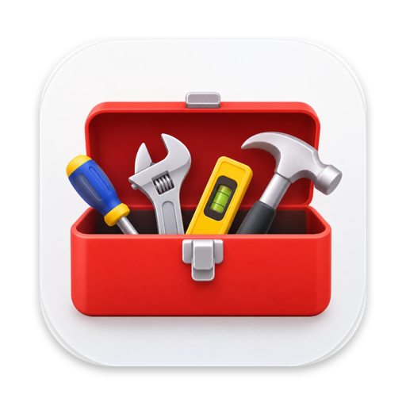
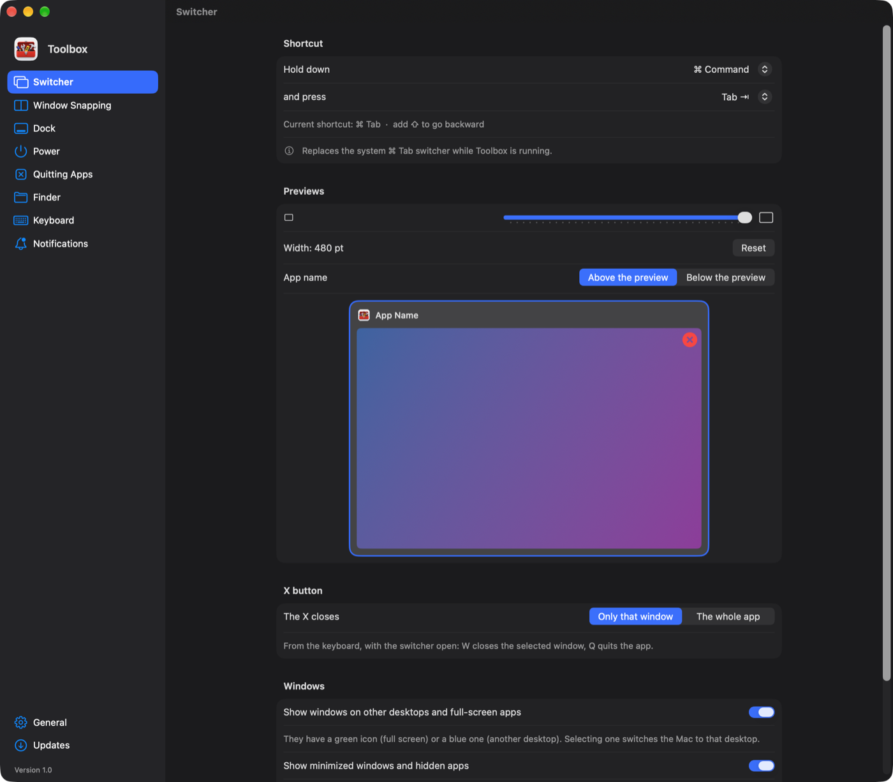
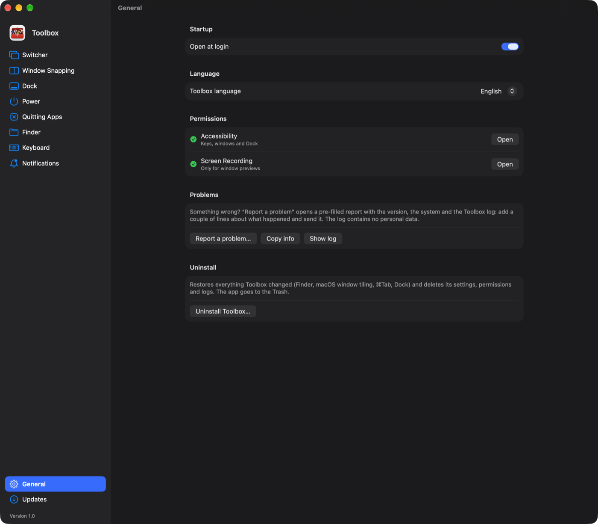

<p align="center">
  
</p>

<h1 align="center">Toolbox</h1>
<p align="center">Le abitudini di Windows portate su macOS: Alt+Tab con le anteprime, finestre affiancate, Esplora file, tasti e scorciatoie come su PC.</p>

<p align="center"><a href="README.md">English</a> · <b>Italiano</b></p>

<p align="center">
  <a href="../../releases/latest">Scarica l'ultima versione</a> ·
  macOS 14 o successivo · Apple Silicon
</p>

<p align="center">
  
  
</p>

## Cosa fa

| | |
|---|---|
| **Switcher** | ⌘Tab (o la scorciatoia che preferisci) mostra **ogni finestra** con la sua anteprima, come Alt+Tab: anche quelle ridotte a icona, nascoste o su altre scrivanie. Con la X o con W/Q chiudi finestre e app. |
| **Affianca finestre** | Come Windows 11: trascina sui bordi per la metà, negli angoli per un quarto, in alto per tutto schermo; il pulsante verde ingrandisce la finestra invece di aprirla a schermo intero; barra dei layout in cima allo schermo, **Snap Assist** per riempire lo spazio libero, finestre affiancate che si ridimensionano insieme. ⌥ + frecce e ⌥Z come Win + frecce e Win+Z. |
| **Zones** | Come FancyZones dei PowerToys: scegli un layout per ogni monitor (colonne, righe, griglia, griglia con priorità, focus) o disegnane uno tuo, a griglia o libero; poi trascina una finestra tenendo premuto ⇧ e lasciala su una zona. Vicino al bordo tra due zone le occupa entrambe, con ⌃ si estende su più zone. ⌥⇧ + il tasto sopra Tab apre l'editor, ⌥⌃⌘ + numero cambia layout. |
| **Scrivania** | Scuoti forte il mouse tenendo premuto ⇧ (o il tasto che scegli) per ridurre a icona tutte le finestre e mostrare la scrivania, rifallo per riportarle com'erano; ⌥D fa lo stesso, come Win+D. **Aero Shake**: scuoti una finestra tenendola per la barra del titolo per ridurre a icona tutte le altre. |
| **Dock** | Anteprime delle finestre passando sopra le icone; un clic sull'icona dell'app in primo piano la riduce a icona, come sulla barra delle applicazioni. Le finestre ridotte a icona vanno nell'icona della loro app invece che accanto al Cestino. |
| **Power** | Un tasto di accensione nel Dock: blocca, standby, spegni lo schermo, riavvia, spegni, con timer. |
| **Chiusura app** | Chiudendo l'ultima finestra l'app esce davvero (come ⌘Q, quindi le app che ripristinano le schede lo fanno), con un elenco di eccezioni per le app da tenere aperte. |
| **Finder** | Invio apre, F2 rinomina, Canc cestina, ⌫ torna indietro (sulla scrivania cestina anche lui), Ctrl+X/Ctrl+V sposta. Estensioni visibili, cartelle prima dei file, dimensioni delle cartelle e altre impostazioni in un clic (sempre ripristinabili). |
| **Esplora file** | Un esploratore di file in stile Windows: barra degli indirizzi, colonne con estensione e dimensioni, anteprime, schede. |
| **Tastiera** | Ctrl+C/V/X/Z/A/S… come su PC, Ctrl+frecce e Ctrl+⌫ sulle parole, Home/Fine, ⌘ destro come AltGr (@, #, €, [ ]), ⌥⇧S per il ritaglio dello schermo come Win+Maiusc+S (lo schermo si congela), maiuscole accentate (È, À, Ò…) con il Blocco maiuscole, Ctrl + rotellina per lo zoom. Le scorciatoie si registrano premendole, anche con i tasti del mouse. |
| **Notifiche** | Notifiche che scendono dall'alto al centro, con il colore dell'app, la durata e lo stile che preferisci. |
| **Sfondo** | Tasto destro su un'immagine nel Finder → *Imposta come sfondo*. |

Ogni funzione si accende e si spegne dalle impostazioni. Toolbox segue la lingua del sistema (italiano e inglese), oppure quella scelta in *Generale*.

## Installazione

1. Scarica `Toolbox-x.y.zip` dall'[ultima versione](../../releases/latest), aprilo e sposta **Toolbox** in *Applicazioni*.
2. Al primo avvio macOS dice che non può verificare lo sviluppatore: apri **Impostazioni di Sistema → Privacy e sicurezza** e scegli **Apri comunque**. Serve solo la prima volta.
3. Concedi i due permessi che Toolbox chiede:
   - **Accessibilità**, per tasti, finestre e Dock;
   - **Registrazione schermo**, solo per le anteprime delle finestre (le immagini restano in memoria, non vengono salvate né inviate).

Con *Affianca finestre* acceso, Toolbox spegne l'affiancamento di macOS, che altrimenti si sovrapporrebbe; spegnendo quello di Toolbox, quello di macOS torna com'era.

Toolbox controlla se ci sono aggiornamenti quando apri le sue impostazioni e non installa nulla senza chiedere; le versioni importanti (per esempio correzioni di sicurezza) arrivano anche come notifica. Se preferisci, in *Aggiornamenti* puoi farle installare automaticamente. Ogni aggiornamento viene installato solo se è firmato con lo stesso certificato della copia che hai già.

Qualcosa non va? *Generale → Segnala un problema* apre una segnalazione già compilata su GitHub con versione, sistema e registro di Toolbox (che non contiene dati personali). *Generale → Disinstalla Toolbox* rimette com'era tutto quello che Toolbox ha cambiato e cancella tutto quello che ha creato.

## Per chi sviluppa

Toolbox è scritto in Swift con AppKit e SwiftUI, senza dipendenze e senza progetto Xcode: basta `swiftc`, incluso negli strumenti da riga di comando di Xcode.

```sh
scripts/build.sh                 # compila, installa in ~/Applications e avvia
NO_INSTALL=1 scripts/build.sh    # compila soltanto, in build/Toolbox.app
UNIVERSAL=1 scripts/build.sh     # Apple Silicon + Intel (serve un SDK che supporta ancora Intel, es. Xcode 26)
```

### Struttura

```
Toolbox/                 l'app principale (barra dei menu)
  App/                   avvio, menu nella barra, permessi, lingua, riavvio, disinstallazione
  EventTap/              un solo CGEventTap per tastiera e mouse, che smista gli eventi alle funzioni
  Core/                  finestre (Accessibilità), schermi, scrivanie, anteprime, indice delle app
  Switcher/              ⌘Tab con le anteprime
  Snap/                  affiancamento: zone e layout, trascinamento, tastiera, Snap Assist
  Zones/                 layout di zone personalizzati (come FancyZones): modello, sovrapposizione, trascinamento, tasti, editor
  Desktop/               mostra la scrivania (scuoti, ⌥D), riduci tutto a icona, Aero Shake
  Dock/                  clic sulle icone, anteprime, icone di Toolbox e Power nel Dock
  AppQuit/               chiusura dell'app con l'ultima finestra
  Finder/                tasti di Esplora risorse, preferenze del Finder, servizio "Imposta come sfondo"
  Keyboard/              scorciatoie Ctrl, tasti di scrittura, AltGr, scorciatoie di sistema
  ScreenSnip/            ritaglio dello schermo
  Notifications/         notifiche in stile Toolbox al posto dei banner di macOS
  Updates/               aggiornamenti da GitHub Releases
  Settings/              preferenze (Settings.swift) e finestra delle impostazioni, una pagina per file
  Diagnostics/           registro, chiusure inaspettate, segnalazione dei problemi
  Resources/             Info.plist e icona
Power/                   app di supporto: il tasto di accensione nel Dock
Explorer/                app di supporto: Esplora file (File Explorer.app; App, Model, Views)
Shared/                  codice usato da più app: nomi delle preferenze, varianti dell'icona Power
Artwork/                 disegni originali delle icone
scripts/                 compilazione, pubblicazione, generazione delle icone
```

Il codice e i testi di base sono in inglese; la traduzione italiana è in `*/Resources/it.lproj/Localizable.strings`. Per aggiungere una lingua basta una cartella `<codice>.lproj` con i file tradotti, più il codice in `CFBundleLocalizations` (Info.plist) e in `AppLanguage`.

Power ed Esplora file vengono compilate come app separate e messe dentro `Toolbox.app/Contents/Helpers`: hanno una propria icona nel Dock.

### Come funziona

- **Eventi.** `EventTap` riceve tasti e clic di tutto il sistema e li passa, in ordine, a: scorciatoie dei tasti del mouse, Snap Assist e ⌥Z se aperti, mostra scrivania, tasti delle zone, affiancamento (⌥ + frecce), tasti del Finder, scorciatoie Ctrl, ritaglio, AltGr e tasti di scrittura, infine allo switcher. La prima funzione che usa un evento lo trattiene; se nessuna lo usa, l'evento arriva all'app come sempre. Il lavoro pesante si fa fuori dal tap, sul ciclo principale.
- **Finestre.** Si leggono e si spostano con le API di Accessibilità (`Core/AXWindow.swift`, `Core/WindowManager.swift`). Le coordinate sono quelle di CoreGraphics, con l'origine in alto a sinistra; `Core/ScreenGeometry.swift` converte da e verso quelle di AppKit.
- **API private.** Poche e dichiarate dove servono: `_AXUIElementGetWindow` (finestra ↔ CGWindowID), `CGSHWCaptureWindowList` (anteprime delle finestre ridotte a icona), `CGSSetSymbolicHotKeyEnabled` (per disattivare il ⌘Tab di sistema finché Toolbox è aperta, e riattivarlo all'uscita) e le funzioni di SkyLight in `Core/Spaces.swift` per le scrivanie.

### Aggiungere un'impostazione

1. Il nome in `Shared/Preferences.swift` (`Pref`).
2. Un accessore con il valore predefinito in `Toolbox/Settings/Settings.swift`, da usare nel codice.
3. Il controllo nella pagina giusta in `Toolbox/Settings/Pages/`, con `@AppStorage(Pref.nome)`.

Per aggiungere una pagina basta un nuovo caso in `SettingsSection` (`Settings/SettingsView.swift`).

### Firma e pubblicazione

Gli aggiornamenti vengono accettati solo se firmati con lo stesso certificato della copia installata, e il permesso Accessibilità resta valido tra una versione e l'altra solo con una firma stabile. Per questo le versioni si firmano sempre con lo stesso certificato di firma del codice (Accesso Portachiavi → Assistente Certificato → Crea un certificato → tipo *Firma del codice*). Il nome si sceglie con `SIGN_IDENTITY`; senza certificato la build usa una firma ad-hoc, che va bene per provare.

```sh
scripts/release.sh 1.1 "Cosa cambia"
scripts/release.sh 1.1 "Cosa cambia" --important "Corregge un problema di sicurezza"
```

Lo script aggiorna il numero di versione, compila, firma, crea lo zip e pubblica la release su GitHub con la GitHub CLI (`gh`). Con `--important` gli utenti ricevono anche una notifica.

Per provare un aggiornamento senza pubblicarlo: `defaults write it.saind.switchtab updateFeedOverride http://127.0.0.1:8000/release.json`, con un JSON nello stesso formato dell'API di GitHub (`tag_name`, `body`, `assets[].browser_download_url`); la firma viene controllata comunque. Per tornare normale: `defaults delete it.saind.switchtab updateFeedOverride`.

## Licenza

[MIT](LICENSE)
