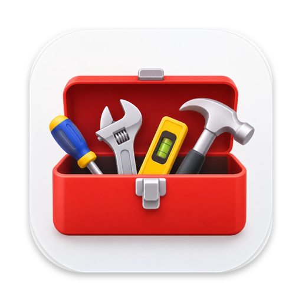
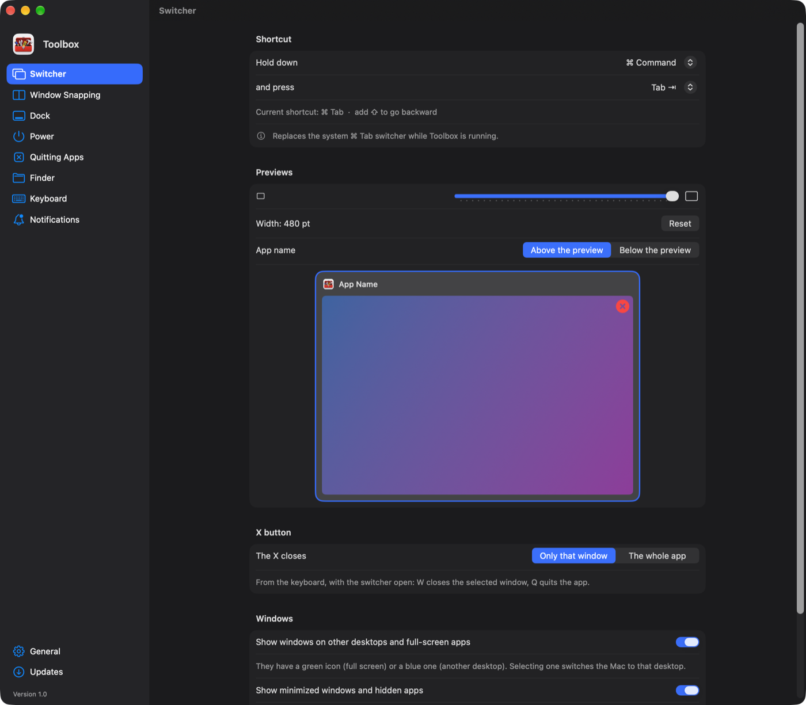
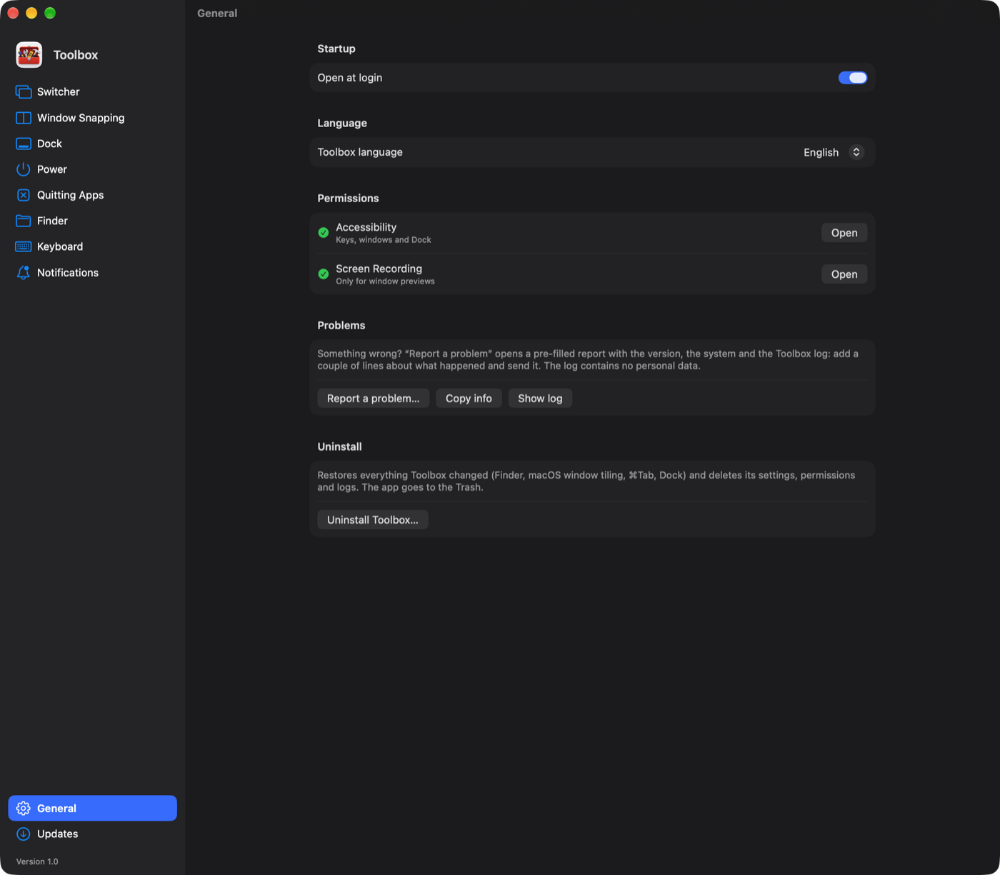

<p align="center">
  
</p>

<h1 align="center">Toolbox</h1>
<p align="center">Windows habits on macOS: Alt+Tab with previews, window snapping, a real file explorer, PC-style keys and shortcuts.</p>

<p align="center"><b>English</b> · <a href="README.it.md">Italiano</a></p>

<p align="center">
  <a href="../../releases/latest">Download the latest version</a> ·
  macOS 14 or later · Apple Silicon
</p>

<p align="center">
  
  
</p>

## Features

| | |
|---|---|
| **Switcher** | ⌘Tab (or the shortcut you prefer) shows **every window** with a live preview, like Alt+Tab — minimized and hidden ones and those on other desktops too. Close windows and apps with the X or with W/Q. |
| **Window snapping** | Like Windows 11: drag to an edge for half the screen, to a corner for a quarter, to the top to fill it; the green button maximizes the window instead of opening it in full screen; a layout bar at the top of the screen, **Snap Assist** to fill the free space, and snapped windows that resize together. ⌥ + arrows and ⌥Z work like Win + arrows and Win+Z. |
| **Zones** | Like FancyZones in PowerToys: pick a layout for each monitor (columns, rows, grid, priority grid, focus) or draw your own, as a grid or freely; then drag a window while holding ⇧ and drop it on a zone. Near the border between two zones it takes both, with ⌃ it spans several. ⌥⇧ + the key above Tab opens the editor, ⌥⌃⌘ + number switches layout. Optionally, the layout follows how many windows are open (two columns with two, a priority grid with three…). |
| **Desktop** | Shake the mouse hard while holding ⇧ (or the key you choose) to minimize every window and show the desktop, and again to bring them back; ⌥D does the same, like Win+D. **Aero Shake**: shake a window by its title bar to minimize all the others. |
| **Dock** | Window previews when hovering Dock icons; clicking the icon of the frontmost app minimizes it, like the Windows taskbar. Minimized windows go into their app's icon instead of next to the Trash. |
| **Power** | A power button in the Dock: lock, sleep, turn off the display, restart, shut down, with a timer. |
| **Quitting apps** | Closing the last window really quits the app (like ⌘Q, so apps that restore their tabs do), with exceptions for apps you want to keep running. |
| **Finder** | Return opens, F2 renames, Delete moves to the Trash, ⌫ goes back (on the desktop it moves to the Trash too), Ctrl+X/Ctrl+V moves files. Visible extensions, folders first, folder sizes and more in one click (always reversible). |
| **File Explorer** | A Windows-style file manager: address bar, columns with extension and size, previews, tabs. |
| **Keyboard** | Ctrl+C/V/X/Z/A/S… like on a PC, Ctrl+arrows and Ctrl+⌫ by word, Home/End, right ⌘ as AltGr (@, #, €, [ ]), ⌥⇧S for a screen snip like Win+Shift+S (the screen freezes), accented capitals (È, À, Ò…) with Caps Lock, Ctrl + wheel to zoom. Shortcuts can be recorded by pressing them, mouse buttons included. |
| **Notifications** | Notifications that slide in at the top center, with the app's color and the duration and style you like. |
| **Wallpaper** | Right-click an image in the Finder → *Set as Desktop Picture*. |

Every feature can be turned on and off in the settings. Toolbox follows the system language (English and Italian), or the one you choose in *General*.

## Installation

1. Download `Toolbox-x.y.zip` from the [latest release](../../releases/latest), open it and move **Toolbox** to *Applications*.
2. On first launch macOS says it can't verify the developer: open **System Settings → Privacy & Security** and choose **Open Anyway**. You only need to do this once.
3. Grant the two permissions Toolbox asks for:
   - **Accessibility**, for keys, windows and the Dock;
   - **Screen Recording**, only for window previews (images stay in memory, they are never saved or sent anywhere).

While *Window snapping* is on, Toolbox turns off macOS's own tiling, which would otherwise get in the way; turning Toolbox's off brings macOS's back as it was.

Toolbox checks for updates when you open its settings and never installs anything without asking; important versions (security fixes, for example) also arrive as a notification. If you prefer, *Updates* can install them automatically. An update is only installed if it is signed with the same certificate as the copy you already have.

Something wrong? *General → Report a Problem* opens a pre-filled GitHub issue with the version, the system and Toolbox's log (which contains no personal data). *General → Uninstall Toolbox* restores everything Toolbox changed and removes everything it created.

## For developers

Toolbox is written in Swift with AppKit and SwiftUI, with no dependencies and no Xcode project: all it needs is `swiftc` from the Xcode command line tools.

```sh
scripts/build.sh                 # build, install in ~/Applications and launch
NO_INSTALL=1 scripts/build.sh    # build only, into build/Toolbox.app
UNIVERSAL=1 scripts/build.sh     # Apple Silicon + Intel (needs an SDK that still supports Intel, e.g. Xcode 26)
```

### Layout

```
Toolbox/                 the main app (menu bar)
  App/                   launch, menu bar menu, permissions, language, relaunch, uninstall
  EventTap/              one CGEventTap for keyboard and mouse that dispatches events to the features
  Core/                  windows (Accessibility), screens, desktops, previews, app index
  Switcher/              ⌘Tab with previews
  Snap/                  snapping: zones and layouts, dragging, keyboard, Snap Assist, macOS tiling
  Zones/                 custom zone layouts (like FancyZones): model, overlay, dragging, keys, editors
  Desktop/               show the desktop (shake, ⌥D), minimize all, Aero Shake
  Dock/                  Dock clicks and previews, Toolbox and Power icons in the Dock
  AppQuit/               quit the app with its last window
  Finder/                Windows Explorer keys, Finder preferences, "Set as Desktop Picture" service
  Keyboard/              Ctrl shortcuts, text keys, AltGr, system shortcuts
  ScreenSnip/            screen snip
  Notifications/         Toolbox-style notifications instead of macOS banners
  Updates/               updates from GitHub Releases
  Diagnostics/           log, crash detection, problem reports
  Settings/              preferences (Settings.swift) and the settings window, one page per file
  Resources/             Info.plist, icon, it.lproj (Italian)
Power/                   helper app: the power button in the Dock
Explorer/                helper app: File Explorer (App, Model, Views)
Shared/                  code used by more than one app: preference names, Power icon variants
Artwork/                 original icon drawings
scripts/                 build, release, icon generation
```

Power and File Explorer are built as separate apps and placed inside `Toolbox.app/Contents/Helpers`, so they get their own Dock icon.

### How it works

- **Events.** `EventTap` receives keys and clicks system-wide and hands them, in order, to: mouse-button shortcuts, Snap Assist and ⌥Z when open, show desktop, zone keys, snapping (⌥ + arrows), Finder keys, Ctrl shortcuts, screen snip, AltGr and text keys, and finally the switcher. The first feature that uses an event swallows it; if none does, the event reaches the app as usual. Heavy work happens outside the tap, on the main run loop.
- **Windows.** Other apps' windows are read and moved through the Accessibility API (`Core/AXWindow.swift`, `Core/WindowManager.swift`); Toolbox's own windows through AppKit (`Core/WindowRef.swift`). Coordinates are CoreGraphics ones, with the origin at the top left; `Core/ScreenGeometry.swift` converts to and from AppKit's.
- **Private APIs.** Few, and declared where they are used: `_AXUIElementGetWindow` (window ↔ CGWindowID), `CGSHWCaptureWindowList` (previews of minimized windows), `CGSSetSymbolicHotKeyEnabled` (to turn off the system ⌘Tab while Toolbox runs, and back on when it quits) and the SkyLight functions in `Core/Spaces.swift` for desktops.

### Adding a setting

1. Its name in `Shared/Preferences.swift` (`Pref`).
2. An accessor with the default value in `Toolbox/Settings/Settings.swift`, to use in code.
3. The control in the right page in `Toolbox/Settings/Pages/`, with `@AppStorage(Pref.name)`.

Adding a page only takes a new case in `SettingsSection` (`Settings/SettingsView.swift`).

### Localization

Source strings are English. SwiftUI literals (`Text("…")`, `Toggle("…")`, …) are localized automatically; strings typed as `String` use `String(localized:)`. The Italian translations live in `Toolbox/Resources/it.lproj/Localizable.strings` (plus the same file for Power and File Explorer). To add a language, add a `<code>.lproj` folder with the translated files and the code to `CFBundleLocalizations` in the Info.plist files and to `AppLanguage`.

### Signing and releasing

Updates are only accepted when signed with the same certificate as the installed copy, and the Accessibility permission only survives from one version to the next with a stable signature. So releases are always signed with the same code signing certificate (Keychain Access → Certificate Assistant → Create a Certificate → type *Code Signing*). Choose it with `SIGN_IDENTITY`; without a certificate the build is signed ad-hoc, which is fine for trying things out.

```sh
scripts/release.sh 1.1 "What's new"
scripts/release.sh 1.1 "What's new" --important "Fixes a security issue"
```

The script bumps the version, builds, signs, zips, commits the version bump and publishes the release on GitHub with the GitHub CLI (`gh`). With `--important` users also get a notification.

To try an update without publishing it: `defaults write it.saind.switchtab updateFeedOverride http://127.0.0.1:8000/release.json`, with a JSON in the same format as GitHub's API (`tag_name`, `body`, `assets[].browser_download_url`); the signature is still checked. To go back: `defaults delete it.saind.switchtab updateFeedOverride`.

## License

[MIT](LICENSE)
